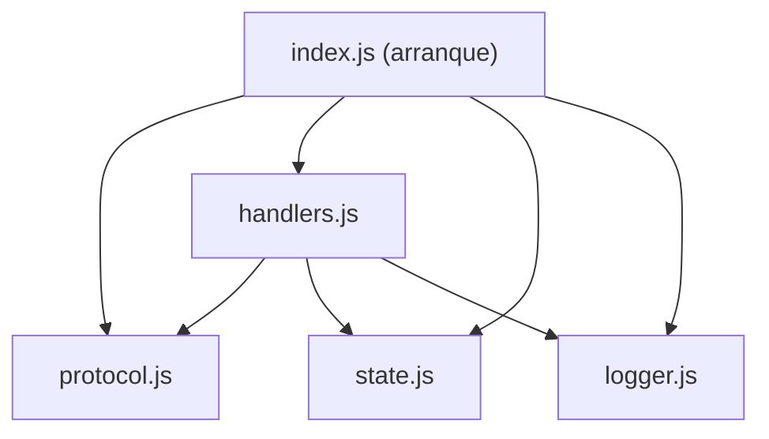
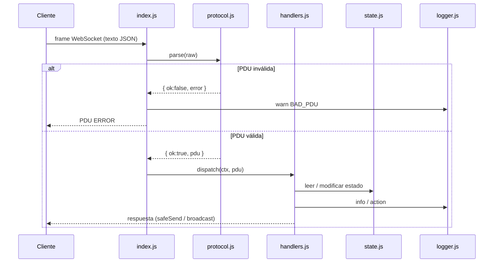

# Etapa 1 — Servidor base (transporte, protocolo, logging, heartbeat)

> Objetivo de la etapa: tener un **servidor central (broker)** que acepte conexiones
> persistentes, entienda el protocolo **JMP**, rechace paquetes inválidos sin caerse,
> autentique usuarios, notifique presencia, detecte desconexiones y **audite todo en un log**.

---

## 0. Mapa general

```
chat-proy/
├── package.json            ← dependencias (express, ws) y scripts npm
├── .gitignore              ← qué NO se sube al repo
├── server/
│   ├── index.js            ← arranque: HTTP + WebSocket + heartbeat
│   ├── protocol.js         ← protocolo JMP: tipos, build(), parse()
│   ├── handlers.js         ← lógica de cada primitiva + router dispatch()
│   ├── state.js            ← estado en memoria: clients y channels
│   ├── logger.js           ← logging a consola + server.log
│   └── uploads/.gitkeep    ← carpeta para archivos (etapa futura)
└── scripts/
    └── test-client.js      ← cliente de consola para probar sin front
```

**Dependencias de módulos** (quién usa a quién):



---

## 1. Inicialización del proyecto

Comandos ejecutados:

```powershell
git init                 # repositorio git
npm init -y              # crea package.json
npm install ws express   # dependencias
```

### `package.json`
| Clave | Valor | Para qué |
|---|---|---|
| `main` | `server/index.js` | Punto de entrada |
| `scripts.start` | `node server/index.js` | Correr en "producción" / defensa |
| `scripts.dev` | `node --watch server/index.js` | Reinicia solo al guardar cambios |
| `dependencies.ws` | WebSockets | Implementación del protocolo WebSocket (RFC 6455) |
| `dependencies.express` | HTTP | Servir el cliente web y la API de archivos |

> Para los IDs se usa `crypto.randomUUID()` **nativo de Node**, no hace falta librería externa.

### `.gitignore`
Excluye `node_modules/`, la base `data/*.db`, `server/uploads/*` y `*.log`: son cosas **generadas en ejecución**, no código.

---

## 2. `server/logger.js` — Logging auditado

Cumple el requisito **"Registro de información (Logging)"**.

**Formato** (exacto al de la especificación):
```
[TIMESTAMP] [NIVEL] [ORIGEN] [EVENTO] Detalle
[2026-10-20 19:06:36] [INFO] [::1:55894] [AUTH] Usuario 'Carlos' autenticado exitosamente (user_e6ac1c81).
```

| Elemento | Línea | Qué hace |
|---|---|---|
| `LOG_FILE` | 10 | Ruta del archivo: `server/server.log` |
| `isNew` + BOM | 11–13 | Si el archivo es nuevo escribe un BOM UTF-8 (`\uFEFF`) para que PowerShell muestre bien las tildes |
| `stream` | 12 | `fs.createWriteStream(..., { flags: 'a' })` → **append** (agrega al final, no pisa) y es **asíncrono** (no bloquea el event loop) |
| `COLORS` | 15 | Color ANSI por nivel, solo para la consola |
| `timestamp()` | 25 | Fecha local `YYYY-MM-DD HH:MM:SS` |
| `log(level, origin, event, detail)` | 32 | Arma la línea, la escribe en el archivo y la imprime con color |
| `module.exports` | final | Atajos por nivel: `info`, `action`, `transfer`, `warn`, `error`, `debug` |

**Niveles** usados: `INFO` (conexiones/auth), `ACTION` (canales), `TRANSFER` (archivos), `WARN` (rechazos, cortes), `ERROR` (excepciones).

**ORIGEN** puede ser `IP:PUERTO`, un username o `Emisor -> Receptor` (se usará en etapas siguientes).

---

## 3. `server/protocol.js` — Protocolo JMP (Capa 7)

Define **cómo se entienden cliente y servidor**. Toda PDU (Protocol Data Unit) es JSON UTF-8:

```json
{
  "head": { "type": "AUTH_REGISTER", "messageId": "uuid-v4", "timestamp": "2026-10-20T22:06:36.405Z" },
  "body": { "username": "Carlos", "status": "Online" }
}
```

- `head` = **encabezado** (como el header de cualquier protocolo: qué es, id, cuándo).
- `body` = **carga útil** (payload), depende del `type`.

| Elemento | Línea | Qué hace |
|---|---|---|
| `TYPES` | 9 | Catálogo de primitivas (congelado con `Object.freeze` para que nadie lo modifique) |
| `SCHEMAS` | 36 | Para cada tipo, qué campos son **obligatorios** en `body` y de qué tipo JS (`string`, `number`) |
| `MAX_PDU_BYTES` | 47 | Límite de 2 MB por paquete (alcanza para un avatar Base64) |
| `build(type, body)` | 50 | **Construye** una PDU: agrega `messageId` (UUID v4) y `timestamp` (ISO 8601 UTC) y la serializa con `JSON.stringify` |
| `parse(raw)` | 61 | **Valida** un paquete recibido. Devuelve `{ ok: true, pdu }` o `{ ok: false, error }` |

### Validaciones de `parse()` (en orden)
1. Tamaño ≤ 2 MB.
2. Es JSON válido (`JSON.parse` dentro de `try/catch`) → si no: `"JSON malformado"`.
3. Es un objeto y tiene `head` objeto.
4. `head.type` es string.
5. `body` (si viene) es objeto; si no viene se usa `{}`.
6. El `type` existe en `SCHEMAS` → si no: `"Tipo desconocido"`.
7. Cada campo obligatorio existe y tiene el tipo correcto.

> **Por qué importa:** cumple "*Validación de entradas… para evitar caídas del servidor ante paquetes malformados*". Un `parse` que devuelve resultado (en vez de tirar excepción) hace que el flujo sea explícito.

### Primitivas definidas
| Grupo | Tipos | Estado |
|---|---|---|
| Sesión | `AUTH_REGISTER`, `AUTH_OK`, `USER_PRESENCE`, `USER_LIST`, `PROFILE_UPDATE` | ✅ AUTH_REGISTER, AUTH_OK, USER_PRESENCE |
| Canales / privados | `JOIN_CHANNEL`, `LEAVE_CHANNEL`, `CHANNEL_LIST`, `CHANNEL_MSG`, `PRIVATE_MSG` | Etapa 2 |
| Archivos | `FILE_OFFER`, `FILE_HTTP_URL` | Etapa 4 |
| Historial | `FETCH_HISTORY`, `HISTORY_RESPONSE` | Etapa 3 |
| Control | `ERROR` | ✅ |

---

## 4. `server/state.js` — Estado interno en memoria

| Elemento | Línea | Estructura |
|---|---|---|
| `clients` | 9 | `Map<userId, { socket, username, status, avatar, ip, port }>` → **ClientsMap** de la spec |
| `channels` | 12 | `Map<channelName, Set<userId>>` → **ChannelsMap**. Arranca con `General`, `Redes`, `Random` |
| `addClient(userId, info)` | 18 | Registra un usuario conectado |
| `removeClient(userId)` | 22 | Lo borra de `clients` **y de todos los canales** |
| `findByUsername(username)` | 27 | Busca un userId por nombre (para evitar duplicados) |
| `joinChannel / leaveChannel` | 32 / 37 | Alta/baja en un canal (se usan en etapa 2) |
| `publicUsers()` | 42 | Lista de usuarios **sin el objeto socket** (lo que se manda a los clientes) |
| `channelList()` | 48 | Lista de canales con cantidad de miembros |

**¿Por qué `Map` y `Set`?** Búsqueda/inserción/borrado en **O(1)**. `Set` evita que un usuario figure dos veces en un canal.

**¿Es "synchronization-safe"?** Sí: Node ejecuta el JS en **un solo hilo** (event loop). Un handler corre completo antes que el siguiente, así que nunca hay dos modificando el `Map` a la vez → **no hacen falta locks/mutex** (en Java/C++ multihilo sí harían falta).

---

## 5. `server/handlers.js` — Lógica de primitivas y router

| Función | Línea | Qué hace |
|---|---|---|
| `safeSend(socket, data)` | 12 | Envía solo si `readyState === OPEN`, dentro de `try/catch` → atrapa **EPIPE** (escribir en socket roto) |
| `broadcast(data, exceptUserId)` | 21 | Envía a **todos** los autenticados, opcionalmente excluyendo uno |
| `sendError(ctx, error)` | 27 | Loguea `[WARN] [REJECTED]` y responde una PDU `ERROR` al cliente |
| `onAuthRegister(ctx, body)` | 33 | Maneja `AUTH_REGISTER` (ver abajo) |
| `onDisconnect(ctx)` | 71 | Saca al usuario del estado y emite `USER_PRESENCE` "Offline" a todos |
| `routes` | 83 | Tabla `tipo → función` (patrón *dispatch table*) |
| `dispatch(ctx, pdu)` | 87 | **Router**: verifica sesión y llama al handler del `type` |

### `onAuthRegister` paso a paso
1. Si el socket ya tiene `userId` → error "Ya estás autenticado".
2. Valida el username con regex: 2–20 caracteres, letras/números/`._-`/tildes.
3. Si ya hay alguien conectado con ese nombre → error.
4. Genera `userId = 'user_' + 8 caracteres de un UUID`.
5. Guarda el `userId` en el `ctx` del socket y llama a `state.addClient(...)`.
6. Log: `[INFO] [IP:PUERTO] [AUTH] Usuario 'X' autenticado exitosamente`.
7. Responde **al propio cliente** `AUTH_OK` con su `userId`, la lista de usuarios y de canales.
8. Hace `broadcast` de `USER_PRESENCE` (`event: 'CONNECTED'`) **a todos menos él**.

### `dispatch` paso a paso
1. Si el tipo **no** es `AUTH_REGISTER` y el socket no está autenticado → `[WARN] [UNAUTHORIZED]` + error.
2. Busca el handler en `routes`; si no existe → "Primitiva aún no implementada".
3. Ejecuta `handler(ctx, body, pdu)`.

> Agregar una primitiva nueva = escribir la función y sumarla a `routes`. Así se va a crecer en las próximas etapas.

---

## 6. `server/index.js` — Arranque del servidor

| Bloque | Líneas | Qué hace |
|---|---|---|
| Constantes | 17–19 | `PORT=3000`, `HEARTBEAT_MS=30000`, `MAX_MISSED_PINGS=2` |
| HTTP (Express) | 22–26 | Sirve `/client` como archivos estáticos y `GET /api/health` (estado) |
| `WebSocketServer` | 29 | Se monta **sobre el mismo servidor HTTP** → un solo puerto. `maxPayload` 2 MB |
| `wss.on('connection')` | 31–72 | Se ejecuta por **cada cliente nuevo** |
| Heartbeat | 75–88 | `setInterval` de ping/pong |
| `server.listen` | 92 | Escucha en el puerto (dual-stack IPv4 + IPv6) |
| `SIGINT` | 97–102 | Ctrl+C → cierra sockets con código 1001 y apaga limpio |

### Qué pasa en cada conexión (`wss.on('connection', (socket, req) => …)`)
1. Lee `req.socket.remoteAddress` y `remotePort` → **IP:PUERTO del cliente** (limpia el prefijo `::ffff:` de IPv4 mapeado en IPv6).
2. Crea el **contexto** `ctx = { socket, ip, port, addr, userId: null, missedPings: 0 }`. Cada socket tiene el suyo.
3. Log `[CONNECT] Nueva conexión socket establecida.`
4. Registra los eventos del socket:

| Evento | Qué hace |
|---|---|
| `'pong'` | Respuesta al ping → `ctx.missedPings = 0` |
| `'message'` | `parse(raw)` → si falla: log `BAD_PDU` + PDU `ERROR`; si pasa: `handlers.dispatch(ctx, pdu)`. **Todo dentro de `try/catch`** |
| `'close'` | Código `1000/1001` = cierre normal (`INFO`); otro (ej. `1006`) = **inesperado** (`WARN`). Luego `onDisconnect(ctx)` |
| `'error'` | Errores de transporte (**ECONNRESET**, **EPIPE**) → log `SOCKET_ERROR` |

5. Guarda `socket._ctx = ctx` para que el heartbeat lo encuentre.

### Heartbeat (Ping/Pong) — detección de desconexiones abruptas
Cada 30 s, para cada socket:
1. Si `missedPings >= 2` → log `[TIMEOUT]` y `socket.terminate()` (cierre duro). Eso dispara `'close'` → `onDisconnect` → `USER_PRESENCE` Offline.
2. Si no, `missedPings++` y envía `socket.ping()` (frame de control **PING** del protocolo WebSocket, opcode `0x9`).
3. Cuando el cliente responde **PONG** (opcode `0xA`, el navegador lo hace automáticamente), el contador vuelve a 0.

> **Por qué hace falta:** si un cliente pierde la red (se cae el Wi-Fi, se cuelga la PC) **TCP no avisa** inmediatamente: el socket queda "medio abierto". El heartbeat lo detecta a nivel aplicación en ≤ 60–90 s.

### Flujo completo de un mensaje



---

## 7. `scripts/test-client.js` — Cliente de prueba por consola

Permite probar el servidor **sin front**.

```powershell
node scripts/test-client.js Carlos
```

- Al conectar envía `AUTH_REGISTER` con el nombre pasado por argumento.
- Imprime todo lo que llega (`<< {...}`).
- Comandos:
  - `TIPO {json}` → envía esa PDU. Ej: `JOIN_CHANNEL {"channel":"Redes"}`
  - `/bad` → manda JSON roto (prueba de validación)
  - `/raw texto` → manda texto crudo
  - `/quit` → cierra con código 1000 (cierre normal)
- `WS_URL` (variable de entorno) permite apuntar a otro servidor: `$env:WS_URL="ws://192.168.1.50:3000"`.

---

## 8. Pruebas realizadas y resultado

| Prueba | Resultado en el log |
|---|---|
| Cliente A se registra como `Carlos` | `[INFO] [::1:55894] [AUTH] Usuario 'Carlos' autenticado…` |
| Cliente B intenta `Carlos` (duplicado) | `[WARN] [REJECTED] El usuario 'Carlos' ya está conectado` |
| B envía `{malo` | `[WARN] [BAD_PDU] JSON malformado` (servidor sigue vivo) |
| B envía `CHANNEL_MSG` sin auth | `[WARN] [UNAUTHORIZED] Intento de CHANNEL_MSG sin autenticar.` |
| B se registra como `Ana` | `AUTH` OK, y **A recibe** `USER_PRESENCE CONNECTED` |
| B se corta abruptamente (`terminate`) | `[WARN] [DISCONNECT] …inesperadamente (code 1006)` y A recibe `USER_PRESENCE` Offline |
| A cierra normal | `[INFO] [DISCONNECT] Conexión cerrada por el cliente` |

Notar que A entró como `::1` (IPv6) y B como `127.0.0.1` (IPv4): **puertos efímeros distintos** (55894 / 55895) → así el SO demultiplexa cada conexión.

### Problema encontrado y resuelto
Inicialmente `server.listen(PORT, '0.0.0.0')` solo escuchaba **IPv4**, pero en Windows `localhost` resuelve primero a **IPv6 `::1`** → `ECONNREFUSED`. Se corrigió quitando el host: Node escucha en `::` **dual-stack** (IPv4 + IPv6).

---

## 9. Preguntas probables en la defensa

**¿En qué capa trabaja la aplicación?**
En la **capa de Aplicación (L7)**. Usamos la API de sockets del SO a través de Node; debajo, **TCP (L4)** garantiza entrega **confiable y ordenada**, IP (L3) el ruteo. WebSocket arranca como un pedido HTTP (`Upgrade: websocket`) y después queda un canal TCP **full-duplex persistente**.

**¿Por qué WebSocket y no HTTP común?**
HTTP es pedido/respuesta: el servidor no puede "empujar" un mensaje. WebSocket mantiene la conexión abierta y ambos lados envían cuando quieren → baja latencia, ideal para chat.

**¿Cómo maneja muchos clientes a la vez?**
**Event loop** de Node con **E/S no bloqueante**: un solo hilo atiende todos los sockets; cuando llega data, el SO (via `epoll`/IOCP) avisa y se ejecuta el callback. No hay un hilo por cliente → menos memoria, sin locks. La alternativa (Java/Python sockets puros) sería **un hilo por socket** o un **ThreadPool**, que necesita sincronizar el estado compartido.

**¿Qué es la multiplexación/demultiplexación acá?**
- **L4:** todos los clientes llegan al **puerto 3000**, pero cada conexión TCP es única por la 4-tupla *(IP origen, puerto origen, IP destino, puerto destino)*. Por eso el log muestra `IP:PUERTO` distinto por cliente.
- **L7:** dentro de cada socket, el campo `head.type` decide **qué handler** procesa el paquete, y (en etapa 2) `channel`/`to` deciden **a qué sockets** se reenvía.

**¿Qué pasa si un cliente manda basura?**
`parse()` lo rechaza, se loguea `BAD_PDU`, se responde `ERROR` y el servidor sigue. Además `dispatch` está en `try/catch` por si un handler falla.

**¿Qué pasa si a un cliente se le corta internet?**
TCP no avisa enseguida. El **heartbeat** manda PING cada 30 s; con 2 sin PONG, `terminate()`, se borra de `clients` y se avisa a todos con `USER_PRESENCE`.

**¿Qué son ECONNRESET y EPIPE?**
- **ECONNRESET:** el otro extremo cerró de golpe (TCP RST).
- **EPIPE:** intentamos escribir en un socket que ya está cerrado.
Ambos se capturan (`socket.on('error')` y `safeSend`) y se loguean sin tirar el servidor.

**¿Por qué el estado no necesita locks?**
Porque el JS corre en un solo hilo: cada callback se ejecuta completo sin interrupciones.

---

## 10. Cómo correrlo

```powershell
npm install
npm run dev                                   # terminal 1: servidor
Get-Content server\server.log -Wait           # terminal 2: log en vivo ("tail -f")
node scripts/test-client.js Carlos            # terminal 3
node scripts/test-client.js Ana               # terminal 4
```
