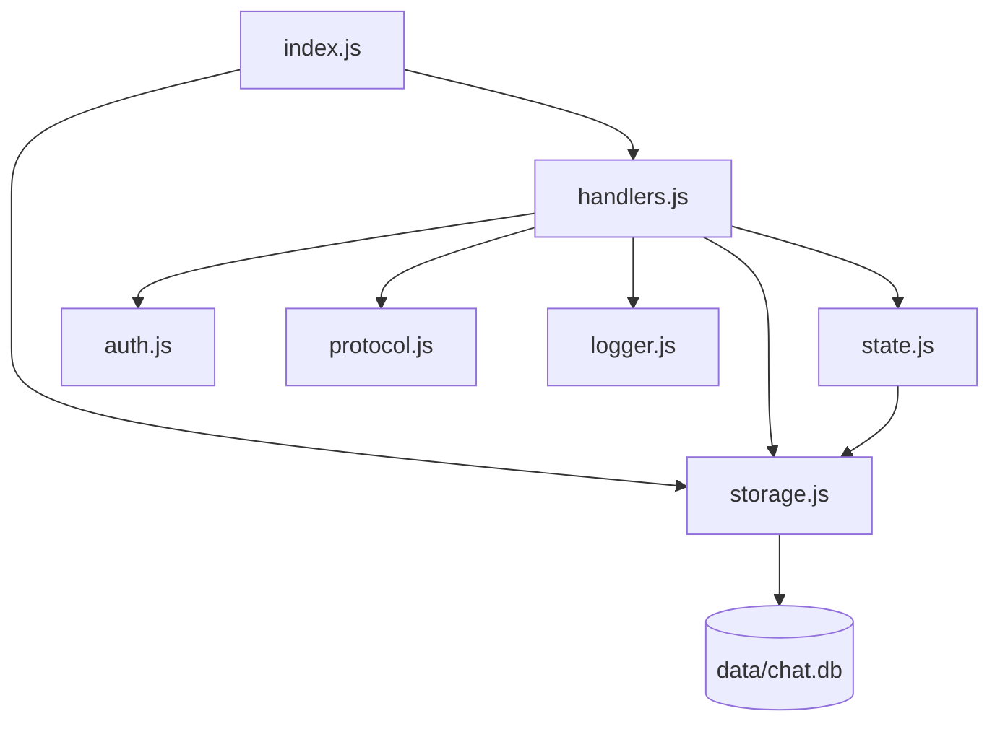
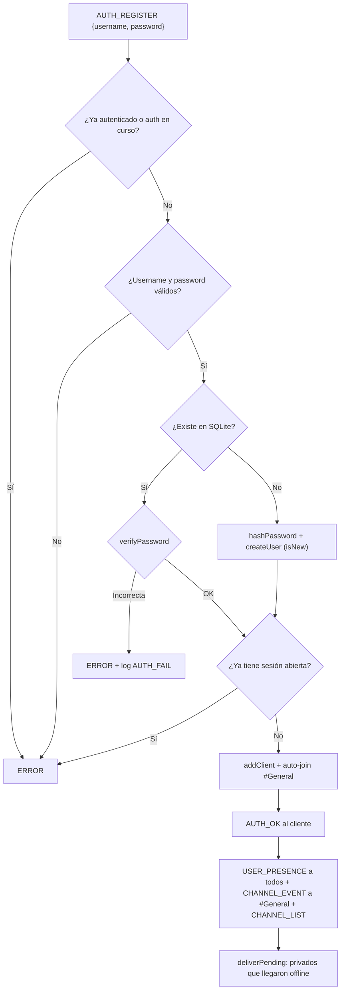

# Etapa 2 — Canales, mensajes privados, persistencia y login

> Objetivo de la etapa: cubrir los requisitos **"múltiples canales y mensajes privados"** y
> **"guardar conversaciones"**, agregando una identidad persistente (usuario + contraseña).

---

## 0. Qué cambió respecto a la Etapa 1

| Archivo | Estado | Resumen |
|---|---|---|
| `server/storage.js` | **Nuevo** | Motor de persistencia SQLite (usuarios, canales, mensajes) |
| `server/auth.js` | **Nuevo** | Hash y verificación de contraseñas con scrypt |
| `server/state.js` | Reescrito | Separa estado volátil (memoria) de persistente (SQLite) |
| `server/handlers.js` | Reescrito | 6 primitivas: AUTH, JOIN, LEAVE, CHANNEL_MSG, PRIVATE_MSG, FETCH_HISTORY |
| `server/protocol.js` | Modificado | Nuevos esquemas y tipo `CHANNEL_EVENT` |
| `server/index.js` | Modificado | Cierra SQLite al apagar; captura errores globales |
| `scripts/test-client.js` | Modificado | Envía contraseña |
| `scripts/test-etapa2.js` | **Nuevo** | 17 tests automáticos end-to-end |

Dependencia nueva: **`better-sqlite3@12`**.

> **Problema encontrado:** la v13 de `better-sqlite3` (la más reciente) crashea con *access violation* (`0xC0000005`) al abrir la base en Node 22.12 sobre Windows. Se fijó la v12, que funciona correctamente (SQLite 3.53).



---

## 1. Decisión de diseño: memoria vs. base de datos

| Dato | Dónde vive | Por qué |
|---|---|---|
| Quién está conectado y su socket | **Memoria** (`state.clients`) | Un socket no se puede guardar en disco; cambia en cada conexión |
| Quién está en qué canal ahora | **Memoria** (`state.channels`) | Es volátil: al desconectarse se pierde |
| Usuarios registrados (credenciales, perfil) | **SQLite** (`users`) | Debe sobrevivir a reinicios |
| Canales existentes | **SQLite** (`channels`) + memoria | Los canales creados por usuarios no se pierden al reiniciar |
| Mensajes | **SQLite** (`messages`) | Requisito "guardar conversaciones" y entrega diferida |

**Por qué cambió la identidad:** en la Etapa 1 el `userId` era aleatorio por conexión. Eso impedía mandar un privado a alguien desconectado o reconstruir su historial. Ahora el `userId` (`u_xxxxxxxx`) se genera una sola vez al registrarse y queda fijo en la base.

---

## 2. `server/storage.js` — StorageEngine (SQLite)

### Configuración

| Línea | Qué hace |
|---|---|
| 21 | `new Database('data/chat.db')`: abre (o crea) el archivo de base |
| 22 | `journal_mode = WAL`: *Write-Ahead Logging*, lecturas y escrituras no se bloquean entre sí |
| 23 | `foreign_keys = ON`: SQLite no valida claves foráneas si no se activa |

### Esquema

```sql
CREATE TABLE users (
  id            TEXT PRIMARY KEY,
  username      TEXT NOT NULL UNIQUE COLLATE NOCASE,  -- "ana" == "Ana"
  password_hash TEXT NOT NULL,                        -- scrypt$salt$hash
  status        TEXT DEFAULT 'Online',
  avatar        TEXT,                                 -- data:image/...;base64 (etapa 3)
  created_at    TEXT NOT NULL,
  last_seen     TEXT
);

CREATE TABLE channels (
  name       TEXT PRIMARY KEY COLLATE NOCASE,
  created_by TEXT,
  created_at TEXT NOT NULL
);

CREATE TABLE messages (
  id          TEXT PRIMARY KEY,
  sender_id   TEXT NOT NULL REFERENCES users(id),
  target_type TEXT NOT NULL CHECK (target_type IN ('CHANNEL','PRIVATE')),
  target_id   TEXT NOT NULL,              -- nombre del canal o id del destinatario
  content     TEXT NOT NULL,
  msg_type    TEXT NOT NULL DEFAULT 'TEXT',
  delivered   INTEGER NOT NULL DEFAULT 1, -- 0 = privado pendiente
  timestamp   TEXT NOT NULL
);
```

Es el esquema de la especificación + la columna **`delivered`** (el "unread" de la spec) y `REFERENCES`/`CHECK` para integridad.

**Índices:**
- `idx_msg_target (target_type, target_id, timestamp)` → acelera `FETCH_HISTORY` (no recorre toda la tabla).
- `idx_msg_pending (target_id, delivered) WHERE delivered = 0` → índice **parcial**: solo indexa los pendientes, que son pocos.

### Sentencias preparadas (`stmts`, línea 66)
Todas las consultas se compilan **una sola vez** con `db.prepare(...)` y se ejecutan con parámetros (`?` o `@nombre`).
- **Rendimiento:** no se re-parsea el SQL en cada mensaje.
- **Seguridad:** los parámetros nunca se concatenan al SQL → **inmunes a SQL injection**. Si alguien manda `'; DROP TABLE users; --` como mensaje, se guarda como texto.

### Funciones

| Función | Línea | Qué hace |
|---|---|---|
| `getUserByName(username)` | 102 | Busca usuario (sin distinguir mayúsculas) |
| `getUserById(id)` | 103 | Busca por id |
| `createUser({...})` | 105 | INSERT de usuario nuevo con id `u_` + 8 chars de UUID |
| `updateProfile(id, {status, avatar})` | 118 | Actualiza solo los campos no nulos (`COALESCE`) |
| `touchUser(id)` | 122 | Actualiza `last_seen` |
| `listUsers()` | 123 | Todos los usuarios **sin** el hash |
| `listChannels / getChannel / createChannel` | 125–127 | Canales persistentes (`INSERT OR IGNORE`) |
| `saveMessage({...})` | 133 | **INSERT** de cada mensaje procesado |
| `getPendingFor(userId)` | 148 | Privados con `delivered = 0` para ese usuario |
| `markDelivered(ids)` | 151 | Marca entregados dentro de **una transacción** (todo o nada) |
| `getHistory(type, id, {requesterId, limit})` | 155 | **SELECT** de los últimos N (máx 200, por defecto 50) |

**Truco del historial:** se piden los últimos 50 con `ORDER BY timestamp DESC LIMIT 50` y una consulta externa los reordena `ASC`. Resultado: los 50 más recientes, en orden cronológico.

**Historial privado:** filtra `(sender = A AND target = B) OR (sender = B AND target = A)`, donde A es **siempre quien pide**. Por eso un tercero no puede leer conversaciones ajenas.

> **Sobre "síncrono":** `better-sqlite3` bloquea mientras ejecuta, pero con base local, sentencias preparadas e índices, cada consulta tarda microsegundos. En la práctica es más rápido que un driver asíncrono, porque se ahorra el ida y vuelta al thread pool.

---

## 3. `server/auth.js` — Contraseñas con scrypt

| Función | Línea | Qué hace |
|---|---|---|
| `hashPassword(password)` | 17 | Genera salt aleatorio (16 bytes), deriva 64 bytes con scrypt, devuelve `scrypt$<salt>$<hash>` |
| `verifyPassword(password, stored)` | 23 | Recalcula con el mismo salt y compara con `crypto.timingSafeEqual` |

**Conceptos para la defensa:**
- **Nunca se guarda la contraseña**, solo el hash. Si roban la base, no tienen las claves.
- **Salt por usuario:** dos usuarios con la misma clave tienen hashes distintos → inutiliza tablas precalculadas (rainbow tables).
- **scrypt** es lento y consume memoria **a propósito**: probar millones de claves por fuerza bruta se vuelve carísimo.
- **`timingSafeEqual`:** compara siempre en el mismo tiempo; una comparación normal corta en el primer byte distinto y eso filtra información (ataque de timing).
- **Asíncrono:** `crypto.scrypt` corre en el **thread pool de libuv**, no en el hilo del event loop. Mientras se calcula un hash (unos ms), el servidor sigue atendiendo los demás sockets. Es un ejemplo concreto de E/S y cómputo no bloqueante.

> **Limitación conocida:** el protocolo viaja sin cifrar (`ws://`). En producción se usaría **`wss://` (WebSocket sobre TLS)** para que la contraseña no viaje en texto plano por la red. Se puede mencionar como mejora.

---

## 4. `server/state.js` — Estado en memoria

| Función | Línea | Qué hace |
|---|---|---|
| `channels` (inicialización) | 16 | Se carga **desde SQLite** al arrancar: `Map<nombre, Set<userId>>` |
| `addClient` | 18 | Alta en `clients` |
| `removeClient` | 23 | Baja de `clients` y de todos los canales; **devuelve los canales que dejó** para avisarles |
| `isOnline` | 32 | ¿Está conectado? |
| `resolveChannel(name)` | 37 | Encuentra el nombre canónico sin distinguir mayúsculas (`redes` → `Redes`) |
| `createChannel` | 43 | Agrega canal vacío al Map |
| `joinChannel / leaveChannel` | 48 / 52 | Alta/baja de miembro |
| `isMember` | 56 | ¿El usuario está en el canal? |
| `channelMembers` | 60 | `Set` de miembros conectados |
| `publicUsers()` | 68 | Combina **todos los registrados** (SQLite) con su estado **online real** (memoria). Así el cliente puede mandar privados a usuarios offline |
| `channelList()` | 82 | `[{ name, members }]` |

---

## 5. `server/handlers.js` — Primitivas

### Utilidades

| Función | Línea | Qué hace |
|---|---|---|
| `safeSend` | 25 | Envío protegido (EPIPE / socket cerrado) |
| `broadcast` | 34 | A todos los conectados |
| `sendToChannel(channel, data, except)` | 41 | **Pub/Sub:** recorre los miembros del canal y envía a sus sockets. Devuelve cuántos lo recibieron |
| `sendError(ctx, error, refType)` | 51 | Log `REJECTED` + PDU `ERROR`. `refType` indica a qué primitiva corresponde el error |
| `broadcastChannelList` | 56 | Envía a todos el `CHANNEL_LIST` actualizado |
| `cleanChannelName` | 61 | Quita `#` y espacios (`"#Redes"` → `"Redes"`) |
| `toWire(row)` | 66 | Convierte una fila de la base al formato del protocolo |

### `onAuthRegister` (línea 86) — registro o login
Una sola primitiva (como pide la spec) con dos comportamientos:



**Detalles de concurrencia** (por ser `async`):
- `ctx.authPending` impide que el mismo socket mande dos AUTH a la vez.
- Después del `await hashPassword` **se vuelve a chequear** que el nombre siga libre: durante la espera, otro socket pudo registrarlo (*condición de carrera*).
- Se verifica que el socket siga abierto: el cliente pudo cerrar mientras se calculaba el hash.

El mensaje de error para usuario inexistente y para clave incorrecta es **el mismo** ("Usuario o contraseña incorrectos"), para no revelar qué usuarios existen.

### `deliverPending` (línea 177) — entrega diferida
Al conectarse, busca en SQLite los privados con `delivered = 0`, los envía con `offline: true` y los marca entregados en una transacción.

### `onDisconnect` (línea 188)
Saca al usuario del estado, actualiza `last_seen` y avisa:
- `CHANNEL_EVENT LEFT` a cada canal donde estaba
- `USER_PRESENCE DISCONNECTED` a todos
- `CHANNEL_LIST` actualizado

### `onJoinChannel` (línea 210)
1. Limpia y valida el nombre (regex: 2–24 caracteres, sin espacios).
2. Si el canal **no existe, lo crea** (en SQLite y memoria) → log `CREATE_CHANNEL`.
3. Si ya es miembro → error.
4. Lo agrega → log `[ACTION] [Carlos] [JOIN_CHANNEL] Unido a canal '#Redes'.`
5. Confirma al cliente, avisa a los miembros (`CHANNEL_EVENT JOINED`) y emite `CHANNEL_LIST`.

### `onLeaveChannel` (línea 238)
Simétrico: baja, confirmación, `CHANNEL_EVENT LEFT`, `CHANNEL_LIST`.

### `onChannelMsg` (línea 263) — Pub/Sub
1. El canal existe y **el emisor es miembro** (si no, error).
2. `validateContent`: no vacío, máx 4000 caracteres.
3. `storage.saveMessage(...)` → **INSERT**.
4. `sendToChannel` → `channels[canal]` → cada `userId` → `clients[userId].socket`.
5. El emisor también lo recibe (confirmación con `id` y `timestamp` del servidor).
6. Log: `[ACTION] [Carlos] [CHANNEL_MSG] '#Redes' -> 3 destinatario(s) (16 caracteres).`

> **Privacidad en el log:** se registra el tamaño, **no el contenido**. El log audita el ruteo, no lee las conversaciones.

### `onPrivateMsg` (línea 284) — Unicast
1. El destinatario existe en SQLite (puede estar offline) y no es uno mismo.
2. ¿Está en `clients`?
   - **Sí:** se guarda con `delivered = 1` y se envía a **su socket**.
   - **No:** se guarda con `delivered = 0` (pendiente).
3. El emisor recibe una copia con `delivered: true/false`.
4. Log: `[ACTION] [Carlos -> Ana] [PRIVATE_MSG] Entregado.` o `...guardado como pendiente.`

### `onFetchHistory` (línea 311)
- `targetType: "CHANNEL"`, `targetId: "Redes"` → últimos 50 del canal.
- `targetType: "PRIVATE"`, `targetId: "Ana"` → conversación **entre quien pide y Ana**.
- `limit` opcional (1–200).
- Responde `HISTORY_RESPONSE { targetType, targetId, messages: [...] }`.

### Router (`routes` línea 343, `dispatch` línea 352)
Novedad: si el handler es `async` devuelve una `Promise`; `dispatch` le engancha un `.catch(...)` para que un error no quede como *unhandled rejection*.

---

## 6. Catálogo de PDUs de la etapa

**Cliente → Servidor**

| type | body |
|---|---|
| `AUTH_REGISTER` | `{ username, password, status?, avatar? }` |
| `JOIN_CHANNEL` | `{ channel }` |
| `LEAVE_CHANNEL` | `{ channel }` |
| `CHANNEL_MSG` | `{ channel, content }` |
| `PRIVATE_MSG` | `{ to: username, content }` |
| `FETCH_HISTORY` | `{ targetType: "CHANNEL" \| "PRIVATE", targetId, limit? }` |

**Servidor → Cliente**

| type | body | Cuándo |
|---|---|---|
| `AUTH_OK` | `{ userId, username, isNew, joined, users, channels }` | Login/registro OK |
| `USER_PRESENCE` | `{ userId, username, status, online, event }` | Alguien se conecta/desconecta |
| `JOIN_CHANNEL` / `LEAVE_CHANNEL` | `{ channel, ok, created? }` | Confirmación |
| `CHANNEL_EVENT` | `{ channel, userId, username, event: JOINED \| LEFT }` | A miembros del canal |
| `CHANNEL_LIST` | `{ channels: [{ name, members }] }` | Cambia la membresía |
| `CHANNEL_MSG` | `{ id, from, channel, content, msgType, timestamp }` | Mensaje en canal |
| `PRIVATE_MSG` | `{ id, from, to, content, timestamp, delivered?, offline? }` | Privado (o copia al emisor) |
| `HISTORY_RESPONSE` | `{ targetType, targetId, messages }` | Respuesta a FETCH_HISTORY |
| `ERROR` | `{ error, refType }` | Cualquier rechazo |

---

## 7. `server/index.js` — cambios
- `SIGINT` ahora llama a `storage.close()` para que SQLite cierre limpio (vuelca el WAL).
- `process.on('uncaughtException')` y `process.on('unhandledRejection')`: última red de seguridad que **registra** el error en el log en lugar de que el proceso muera sin rastro.

---

## 8. Tests — `scripts/test-etapa2.js`

```powershell
npm start        # terminal 1
npm test         # terminal 2
```

Usa la clase `TestClient` (buzón de mensajes + `waitFor(type, predicado)`) y nombres con sufijo aleatorio para poder correrse muchas veces sobre la misma base.

| # | Test | Verifica |
|---|---|---|
| 1 | Registro nuevo | `isNew: true` y auto-join a `#General` |
| 2 | Contraseña incorrecta | Rechazo |
| 3 | Sesión duplicada | Rechazo |
| 4 | Presencia | Los demás reciben `USER_PRESENCE CONNECTED` |
| 5 | JOIN `#Redes` | Normaliza `#Redes` → `Redes` |
| 6 | No miembro escribe | Rechazo |
| 7 | Pub/Sub | Mensaje en `#Redes` **no** llega a quien no es miembro |
| 8 | Broadcast de canal | Mensaje en `#General` llega a todos |
| 9 | Crear canal | `created: true` |
| 10 | Nombre inválido | Rechazo |
| 11 | Privado online | Entrega inmediata + copia con `delivered: true` |
| 12 | Privado offline | `delivered: false` → al reconectar llega con `offline: true` |
| 13 | Destinatario inexistente | Rechazo |
| 14 | Historial de canal | Contiene el mensaje, en orden cronológico |
| 15 | Historial privado | Devuelve la conversación |
| 16 | Privacidad | Un tercero obtiene 0 mensajes de una conversación ajena |
| 17 | Desconexión | `USER_PRESENCE DISCONNECTED` |

**Resultado: 17/17 OK.**

### Extracto real del `server.log`
```
[19:27:43] [INFO] [::1:56696] [AUTH] Usuario 'Carlos_ahlt' registrado exitosamente (u_55c11be4).
[19:27:43] [ACTION] [Carlos_ahlt] [JOIN_CHANNEL] Unido automáticamente a canal '#General'.
[19:27:43] [WARN] [::1:56699] [AUTH_FAIL] Contraseña incorrecta para 'Carlos_ahlt'.
[19:27:44] [WARN] [::1:56700] [REJECTED] El usuario 'Carlos_ahlt' ya tiene una sesión abierta
[19:27:44] [ACTION] [Carlos_ahlt] [JOIN_CHANNEL] Unido a canal '#Redes'.
[19:27:44] [WARN] [Ana_ahlt] [REJECTED] Debés unirte a '#Redes' antes de escribir
[19:27:44] [ACTION] [Carlos_ahlt] [CHANNEL_MSG] '#Redes' -> 1 destinatario(s) (16 caracteres).
[19:27:44] [ACTION] [Ana_ahlt] [CHANNEL_MSG] '#General' -> 3 destinatario(s) (12 caracteres).
[19:27:44] [ACTION] [Ana_ahlt] [CREATE_CHANNEL] Canal '#TP_ahlt' creado.
[19:27:44] [ACTION] [Carlos_ahlt -> Ana_ahlt] [PRIVATE_MSG] Entregado.
[19:27:44] [ACTION] [Carlos_ahlt -> Pedro_ahlt] [PRIVATE_MSG] Destinatario offline: guardado como pendiente.
[19:27:44] [ACTION] [Pedro_ahlt] [DELIVER_PENDING] 1 mensaje(s) privado(s) entregado(s) al reconectar.
[19:27:44] [ACTION] [Carlos_ahlt] [FETCH_HISTORY] #Redes: 1 mensaje(s).
```

---

## 9. Preguntas probables en la defensa

**¿Cómo funciona el envío a un canal?**
Patrón **Publicador/Suscriptor**. El canal es un "tema"; los miembros son suscriptores. Al llegar un `CHANNEL_MSG`, el servidor consulta `channels.get(canal)` (un `Set` de userIds), busca cada socket en `clients` y le escribe. El emisor no conoce a los receptores: el broker desacopla.

**¿Y un privado?**
**Unicast:** el servidor resuelve `username → userId → socket` y escribe solo en ese socket. Es la **demultiplexación de capa 7**: el campo `to` del body decide a qué conexión TCP va el dato.

**¿Qué pasa si el destinatario está desconectado?**
Se guarda con `delivered = 0`. Cuando se autentica, `deliverPending` le envía todo lo pendiente y lo marca entregado. Es el mismo principio que el *store-and-forward* del correo electrónico.

**¿Cómo se guardan las conversaciones?**
Cada mensaje aceptado hace un INSERT en `messages` (SQLite). `FETCH_HISTORY` hace un SELECT indexado de los últimos 50.

**¿Por qué SQLite y no un JSON?**
Un JSON hay que reescribirlo entero en cada mensaje (lento y riesgoso si se corta la luz a mitad de escritura). SQLite tiene transacciones **ACID**, índices y consultas, en un solo archivo y sin servidor aparte.

**¿Por qué no se bloquea el servidor con SQLite síncrono?**
Las consultas son locales, preparadas e indexadas: microsegundos. Lo costoso de verdad (scrypt) sí es asíncrono y corre fuera del event loop.

**¿Cómo se protegen las contraseñas?**
scrypt + salt por usuario + comparación en tiempo constante. La base nunca tiene la clave. Mejora pendiente: `wss://` (TLS) para cifrar el transporte.

**¿Hay riesgo de SQL injection?**
No: todas las consultas son sentencias preparadas con parámetros; el contenido del usuario nunca se concatena al SQL.

**¿Puede alguien leer los privados de otro?**
No. El historial privado siempre se filtra usando el `userId` de **la sesión que pide** (lo asigna el servidor al autenticar, no lo manda el cliente). Lo verifica el test 16.
