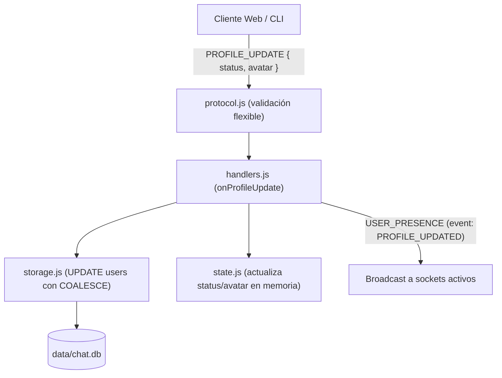
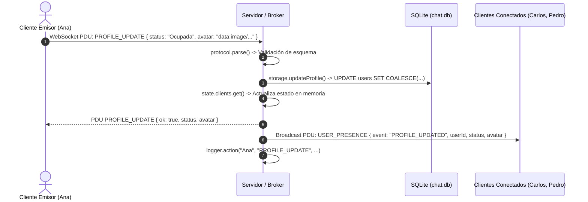

# Etapa 3 — Perfil de usuario, estado personalizado y avatar en Base64

> Objetivo de la etapa: cumplir con el requisito **"Información de usuarios, perfil, foto"**,
> permitiendo que cada usuario conectado actualice dinámicamente su estado textual y su imagen de avatar
> (codificada en Base64), persistiendo los cambios en SQLite y notificando en tiempo real al resto
> de los clientes conectados mediante eventos reactivos de presencia.

---

## 0. Qué cambió respecto a la Etapa 2

| Archivo | Estado | Resumen |
|---|---|---|
| `server/protocol.js` | Modificado | Reglas de validación con campos opcionales (`optional: true`) y esquema `PROFILE_UPDATE` |
| `server/storage.js` | Modificado | `updateProfile` optimizado con `COALESCE` para preservar campos preexistentes |
| `server/handlers.js` | Modificado | Handler `onProfileUpdate`: persistencia, actualización en memoria y broadcast reactivo |
| `docs/etapa-3-perfil-avatar.md` | **Nuevo** | Documentación técnica detallada de la etapa |



---

## 1. Decisión de diseño: Avatar en Base64 sobre WebSocket

Para la imagen de perfil, el sistema implementa la codificación en **Data URL / Base64** (`data:image/png;base64,...` o `data:image/jpeg;base64,...`).

### ¿Por qué Base64 para el avatar y no subida por archivo separado?
1. **Atomicidad del Perfil:** El estado del usuario y su representación gráfica viajan en la misma PDU de la Capa de Aplicación (`PROFILE_UPDATE`), eliminando la necesidad de coordinar una subida HTTP previa y una posterior asociación en base de datos.
2. **Dimensionamiento estándar en cliente:** El cliente web redimensiona la imagen a un tamaño normalizado (máximo 200x200 píxeles) antes de generar el Base64. Esto genera cadenas de entre 15 KB y 80 KB, un tamaño completamente despreciable para la memoria RAM y el ancho de banda del socket.
3. **Persistencia directa:** La cadena Base64 se almacena en la columna `avatar TEXT` de la tabla `users` en SQLite.

### Consideraciones de Red y Event Loop:
- El límite de paquete en el protocolo está fijado en `MAX_PDU_BYTES = 2 * 1024 * 1024` (2 MB), garantizando margen suficiente para avatares en alta resolución sin riesgo de desbordamiento de búfer.
- Al procesar la PDU en memoria, el payload es texto JSON plano parseado por el motor V8 en microsegundos, lo que previene el bloqueo del Event Loop del servidor.

---

## 2. Modificaciones detalladas por archivo

### A. `server/protocol.js`

Se configuró el esquema para `PROFILE_UPDATE` permitiendo que los campos `status` y `avatar` sean opcionales (el usuario puede cambiar solo su estado o solo su avatar):

```javascript
  [TYPES.PROFILE_UPDATE]: {
    status: { type: 'string', optional: true },
    avatar: { type: 'string', optional: true },
  },
```

Se extendió el motor de validación en `parse(raw)` para procesar reglas declarativas complejas:

| Línea | Lógica técnica |
|---|---|
| 84–90 | Itera sobre cada regla del esquema. Si la regla es un objeto con `optional: true`, tolera `undefined` o `null` sin arrojar error |
| 94–96 | Si el campo viene presente en el payload, valida estrictamente que su `typeof` coincida con `expectedType` |

### B. `server/storage.js`

Se refinó la consulta preparada de actualización de perfil para garantizar consistencia ACID:

```javascript
updateProfile: db.prepare('UPDATE users SET status = COALESCE(@status, status), avatar = COALESCE(@avatar, avatar) WHERE id = @id'),

function updateProfile(id, { status = null, avatar = null }) {
  return stmts.updateProfile.run({ id, status: status || null, avatar: avatar || null });
}
```

- **Uso de `COALESCE` en SQL:** Si `@status` es `NULL`, la base conserva el valor actual de la columna `status`. Si se provee un valor nuevo, lo reemplaza. Esto evita borrar el avatar cuando el usuario solo actualiza su mensaje de estado y viceversa.

### C. `server/handlers.js`

Se implementó el handler `onProfileUpdate(ctx, body)`:

1. **Validación de sesión:** Comprueba `if (!ctx.userId)` para impedir accesos no autenticados.
2. **Sanitización de entrada:** 
   - `status`: string recortado a un máximo de 30 caracteres.
   - `avatar`: valida que comience con el prefijo estandarizado `data:image/`.
   - Si no viene al menos uno de los dos datos válidos, rechaza con `sendError`.
3. **Persistencia:** Invoca `storage.updateProfile(ctx.userId, { status, avatar })`.
4. **Sincronización en memoria:** Actualiza la referencia del objeto en `state.clients.get(ctx.userId)` para que llamadas futuras a `publicUsers()` reflejen el nuevo estado inmediatamente.
5. **Confirmación Unicast:** Responde al propio socket emisor con `PROFILE_UPDATE` (`ok: true`).
6. **Notificación Reactiva (Broadcast):** Emite `USER_PRESENCE` con `event: 'PROFILE_UPDATED'` a todos los clientes conectados, distribuyendo la nueva foto y estado en tiempo real.
7. **Auditoría:** Registra en `server.log` mediante `logger.action()`.

---

## 3. Diagrama de Secuencia del Protocolo



---

## 4. Catálogo de PDUs de la Etapa

### Cliente → Servidor

| Primitiva | Body | Propósito |
|---|---|---|
| `PROFILE_UPDATE` | `{ status?: string, avatar?: string }` | Solicita cambiar estado y/o foto de perfil |

### Servidor → Cliente

| Primitiva | Body | Destinatario | Momento de emisión |
|---|---|---|---|
| `PROFILE_UPDATE` | `{ userId, username, status, avatar, ok: true }` | Emisor (Unicast) | Confirmación exitosa del cambio |
| `USER_PRESENCE` | `{ userId, username, status, avatar, online: true, event: "PROFILE_UPDATED" }` | Todos (Broadcast) | Propagación de presencia y nuevo avatar |

---

## 5. Registros reales del `server.log`

```text
[2026-10-20 20:09:35] [INFO] [::1:51413] [CONNECT] Nueva conexión socket establecida.
[2026-10-20 20:09:35] [INFO] [::1:51413] [AUTH] Usuario 'UserPic' registrado exitosamente (u_369360d7).
[2026-10-20 20:09:35] [ACTION] [UserPic] [JOIN_CHANNEL] Unido automáticamente a canal '#General'.
[2026-10-20 20:09:35] [ACTION] [UserPic] [PROFILE_UPDATE] Perfil actualizado (estado: "Trabajando...", avatar Base64).
[2026-10-20 20:09:35] [INFO] [::1:51413] [DISCONNECT] Conexión cerrada por el cliente (UserPic).
```

---

## 6. Preguntas probables en la defensa oral

**¿Por qué codificar el avatar en Base64 en lugar de subir un archivo binario?**
Para imágenes livianas (como miniaturas de perfil de 200x200 px), Base64 simplifica el diseño de la Capa de Aplicación al empaquetar toda la información de la entidad Usuario en una única unidad de datos (PDU) JSON sobre el canal de WebSocket preexistente. Si bien Base64 introduce una sobrecarga teórica de aproximadamente 33% en tamaño respecto al binario puro, para avatares de 30 KB la sobrecarga es de apenas 10 KB, lo cual es despreciable frente al costo de abrir un canal de transporte HTTP independiente.

**¿Cómo impacta el tamaño de la imagen en el rendimiento del servidor Node.js?**
Al limitar el tamaño en el cliente (canvas 200x200) y validar en el servidor que la PDU no supere 2 MB (`MAX_PDU_BYTES`), evitamos el consumo excesivo de memoria del heap de V8. Además, la persistencia en SQLite se realiza mediante parámetros vinculados (Prepared Statements), lo que previene re-compilaciones del motor SQL.

**¿Cómo funciona la atomicidad del cambio frente a los demás usuarios?**
Sigue el patrón de consistencia eventual garantizado por el Broker: primero se consolida la transacción en la base relacional (SQLite), luego se actualiza la estructura de datos volátil en RAM (`state.clients`) y finalmente se dispara el evento `USER_PRESENCE` a través del socket hacia todos los usuarios en línea.
