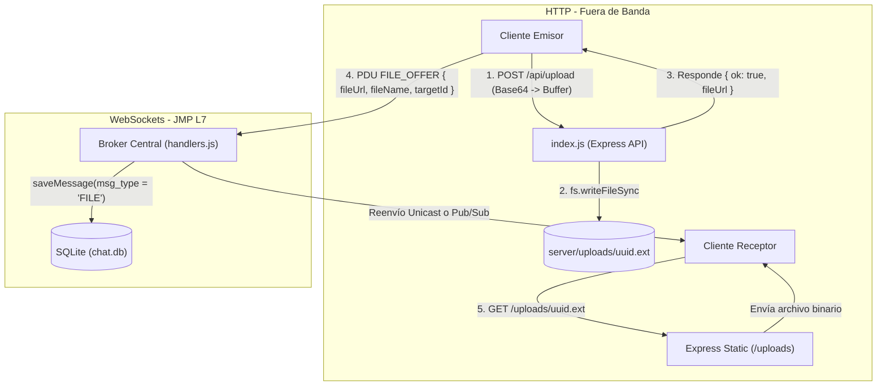
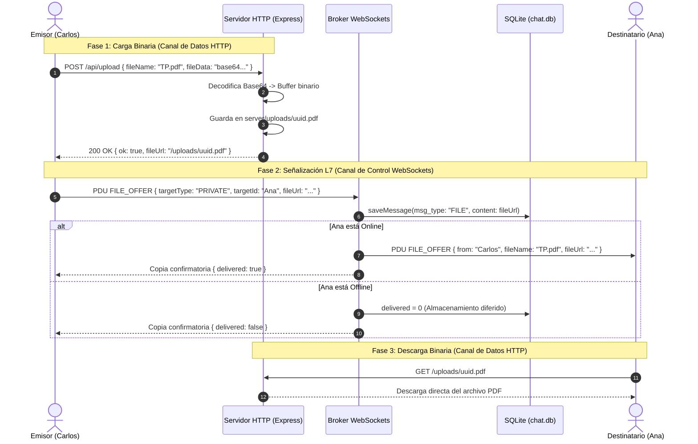

# Etapa 4 — Transferencia de archivos (Método híbrido HTTP / WebSockets)

> Objetivo de la etapa: cumplir con el requisito **"Opción para enviar archivos a un usuario determinado"**
> (y extenderlo a canales grupales), implementando una arquitectura híbrida de alto rendimiento:
> transferencia masiva de datos fuera de banda mediante **HTTP POST/GET** y señalización en tiempo real
> mediante el protocolo de aplicación **JMP sobre WebSockets**.

---

## 0. Qué cambió respecto a la Etapa 3

| Archivo | Estado | Resumen |
|---|---|---|
| `server/index.js` | Modificado | Endpoint `POST /api/upload`, parser JSON de 10 MB y servicio estático `/uploads` |
| `server/protocol.js` | Modificado | Esquema estricto de PDU `FILE_OFFER` (`targetType`, `targetId`, `fileName`, `fileUrl`, `fileSize`) |
| `server/handlers.js` | Modificado | Handler `onFileOffer`: ruteo Pub/Sub o Unicast, soporte offline y auditoría `logger.transfer` |
| `docs/etapa-4-transferencia-archivos.md` | **Nuevo** | Documentación técnica detallada de la etapa |



---

## 1. Fundamento Arquitectónico: Enfoque Híbrido Sockets / HTTP

La especificación técnica contemplaba dos caminos:
- **Enfoque A: Híbrido Sockets/HTTP (Implementado):** Los archivos binarios viajan mediante peticiones HTTP estándar; los sockets solo transportan los metadatos de señalización.
- **Enfoque B: Chunks 100% sobre Sockets:** Fragmentación manual en paquetes de 64 KB en Base64 sobre el socket.

### Justificación de Ingeniería para la Elección del Enfoque Híbrido:
1. **Separación de Canal de Control y Canal de Datos (Out-of-Band Data Transfer):**
   Este patrón es un clásico en protocolos de telecomunicaciones y redes (ej: **FTP** con puertos 21 de comando y 20 de datos, o **SIP/RTP** en VoIP). El canal de WebSocket se reserva exclusivamente para paquetes de baja latencia (mensajes de chat, eventos de presencia). Si se transmitieran megabytes de archivos binarios directamente sobre el WebSocket en Base64, se saturaría la cola de salida del socket TCP (`backpressure`), bloqueando los pings del heartbeat y degradando la latencia del chat interactivo.
2. **Aprovechamiento de las capacidades de transporte de HTTP:**
   HTTP cuenta de manera nativa con streaming de datos, negociación de tipos MIME (`Content-Type`), descargas reanudables por rangos (`Range requests`), caché de navegador y optimizaciones del kernel (`sendfile` de Linux / TransmitFile de Windows).
3. **Escalabilidad y Seguridad:**
   La carpeta `server/uploads/` genera identificadores únicos pseudo-aleatorios mediante UUID v4 (`randomUUID()`), evitando colisiones de nombres de archivos y ataques de sobrescritura de ficheros.

---

## 2. Modificaciones detalladas por archivo

### A. `server/index.js` — Servidor HTTP y API de Carga

1. **Directorio físico y middleware estático:**
   ```javascript
   const UPLOADS_DIR = path.join(__dirname, 'uploads');
   fs.mkdirSync(UPLOADS_DIR, { recursive: true });
   app.use('/uploads', express.static(UPLOADS_DIR));
   ```
   Crea la carpeta si no existe y expone el directorio mediante el middleware `express.static`, permitiendo descargas directas vía HTTP GET.

2. **Límite de payload:**
   ```javascript
   app.use(express.json({ limit: '10mb' }));
   ```
   Permite recibir payloads JSON de hasta 10 MB para soportar archivos de tamaño mediano (documentos PDF, imágenes en alta resolución, archivos comprimidos ZIP).

3. **Endpoint `POST /api/upload`:**
   - **Extracción y decodificación binaria:** Detecta si la carga útil contiene el encabezado MIME Data URL (`data:...;base64,`) o Base64 puro. Convierte la cadena directamente a un `Buffer` binario en memoria mediante `Buffer.from(base64Content, 'base64')`.
   - **Sanitización del nombre de archivo:** Extrae la extensión (`path.extname`) eliminando caracteres especiales para mitigar vulnerabilidades de inyección en el sistema de archivos.
   - **Escritura en disco:** Almacena el buffer sincrónicamente (`fs.writeFileSync`) con un nombre único basado en UUID v4.
   - **Respuesta estructurada:** Devuelve `{ ok: true, fileUrl: '/uploads/uuid.ext', fileName, fileSize }`.

### B. `server/protocol.js` — Esquema de la PDU `FILE_OFFER`

Se actualizó la definición en `SCHEMAS`:

```javascript
  [TYPES.FILE_OFFER]: {
    targetType: 'string', // 'CHANNEL' o 'PRIVATE'
    targetId: 'string',   // Nombre del canal o username del destinatario
    fileName: 'string',
    fileUrl: 'string',
    fileSize: 'number',
  },
```

Garantiza que ningún cliente pueda inyectar un paquete de oferta de archivo sin especificar hacia dónde se dirige (`targetType`), a quién (`targetId`) y el enlace seguro de descarga (`fileUrl`).

### C. `server/handlers.js` — Lógica de Señalización y Persistencia

Se creó la función handler `onFileOffer(ctx, body)`:

1. **Ruteo a Canales (Pub/Sub):**
   - Comprueba que el canal exista en memoria y que el usuario sea miembro activo (`state.isMember`).
   - Persiste en SQLite invocando `storage.saveMessage` con `msg_type: 'FILE'` y `content: fileUrl`.
   - Retransmite la PDU `FILE_OFFER` a todos los sockets conectados al canal mediante `sendToChannel()`.
   - Audita en el log mediante `logger.transfer()`.

2. **Ruteo Privado (Unicast):**
   - Verifica la existencia del destinatario en la base de datos relacional.
   - Si el destinatario está en línea (`state.clients.has`), despacha la PDU de forma inmediata (`safeSend`) con `delivered = 1`.
   - Si el destinatario está desconectado (*offline*), el registro se persiste en SQLite con `delivered = 0` y `msg_type = 'FILE'`.
   - El emisor recibe una copia de confirmación con la propiedad `delivered: true/false`.

3. **Soporte Offline en `deliverPending()`:**
   - Cuando un usuario desconectado inicia sesión, el método `deliverPending` recupera los mensajes pendientes. Si detecta `row.msg_type === 'FILE'`, emite automáticamente un paquete `FILE_OFFER` con el enlace de descarga para que el receptor pueda obtenerlo inmediatamente.

---

## 3. Diagrama de Flujo del Proceso de Transferencia



---

## 4. Catálogo de PDUs de la Etapa

### Cliente → Servidor

| Primitiva | Body | Propósito |
|---|---|---|
| `FILE_OFFER` | `{ targetType, targetId, fileName, fileUrl, fileSize }` | Notifica al broker que un archivo fue subido y debe ser ofrecido |

### Servidor → Cliente

| Primitiva | Body | Destinatario | Momento de emisión |
|---|---|---|---|
| `FILE_OFFER` | `{ id, from, targetType, targetId, fileName, fileUrl, fileSize, timestamp }` | Miembros de canal o Destinatario privado | Retransmisión de la oferta de archivo |
| `FILE_OFFER` | `{ ..., delivered: boolean }` | Emisor original | Confirmación de entrega o aviso de encolado offline |
| `FILE_OFFER` | `{ ..., offline: true }` | Destinatario reconectado | Entrega diferida al iniciar sesión |

---

## 5. Registros reales del `server.log`

```text
[2026-10-20 20:14:11] [INFO] [::1] [UPLOAD] Archivo subido: 'TP7_Redes.pdf' (0.0 KB) -> /uploads/e6eca9c3-bc1c-462c-adc0-82b6f86db6f0.pdf
[2026-10-20 20:14:11] [INFO] [::1:55723] [CONNECT] Nueva conexión socket establecida.
[2026-10-20 20:14:11] [INFO] [::1:55723] [AUTH] Usuario 'DocSender' registrado exitosamente (u_7bf3d7db).
[2026-10-20 20:14:11] [ACTION] [DocSender] [JOIN_CHANNEL] Unido automáticamente a canal '#General'.
[2026-10-20 20:14:11] [TRANSFER] [DocSender] [FILE_OFFER] Canal '#General': archivo 'TP7_Redes.pdf' (0.0 KB) -> 1 destinatario(s).
```

---

## 6. Preguntas probables en la defensa oral

**¿Por qué se eligió el enfoque híbrido en lugar de transmitir los archivos por el WebSocket?**
Se adoptó el principio de **desacoplamiento entre canal de señalización y canal de transporte masivo**. Enviar archivos binarios pesados a través del socket persistente generaría saturación del canal (`socket backpressure`), incrementando la latencia de los mensajes interactivos de texto y poniendo en riesgo el mecanismo de Heartbeat (los paquetes Ping/Pong podrían encolarse y provocar desconexiones espurias por timeout). HTTP está diseñado para la transferencia eficiente de recursos estáticos.

**¿Qué similitud teórica tiene esta arquitectura con otros protocolos de la capa de aplicación?**
Es análogo a la arquitectura de **FTP** (File Transfer Protocol, RFC 959), donde coexisten dos conexiones TCP separadas: una conexión de control (puerto 21) para comandos (`USER`, `PASS`, `LIST`, `RETR`) y conexiones de datos independientes (puerto 20 o puertos dinámicos en modo PASV) dedicadas a la transferencia binaria de bytes. En nuestro sistema, el WebSocket actúa como canal de control persistente (JMP) y HTTP actúa como canal de datos.

**¿Cómo se garantiza que dos usuarios que suben un archivo con el mismo nombre no se sobrescriban?**
En la Capa de Aplicación, el servidor genera un identificador único universal (UUID v4) mediante `crypto.randomUUID()` al momento de persistir el archivo en disco (`server/uploads/<uuid>.<ext>`). El nombre original provisto por el usuario solo se almacena como metadato informativo en la base de datos y en la PDU `FILE_OFFER`.

**¿Qué sucede si un usuario envía un archivo a un destinatario desconectado?**
El archivo se guarda en el disco del servidor mediante HTTP POST y el registro de base de datos se marca con `delivered = 0` y `msg_type = 'FILE'`. Cuando el destinatario se conecta y completa la autenticación (`AUTH_REGISTER`), el método `deliverPending` recupera el registro y le emite la PDU `FILE_OFFER` con el enlace de descarga, garantizando entrega confiable y asíncrona.
